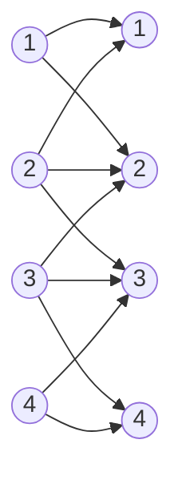
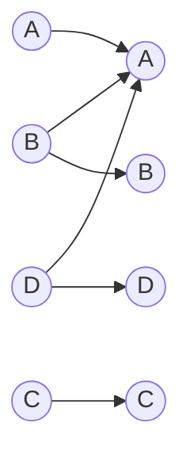
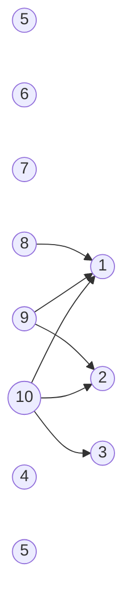
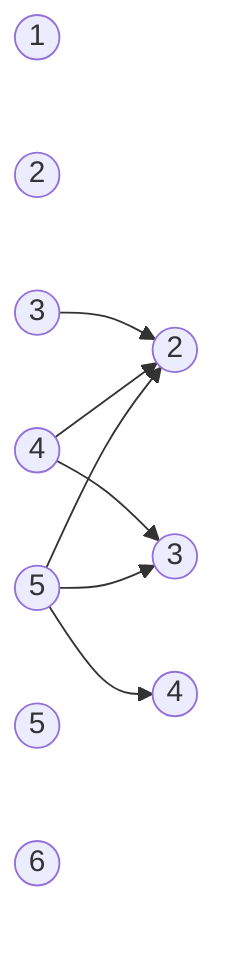
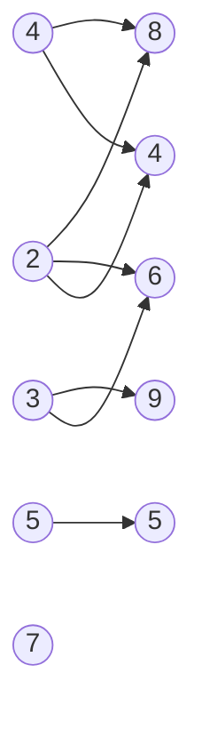
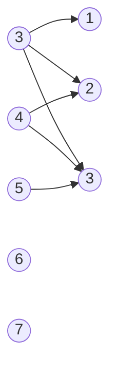
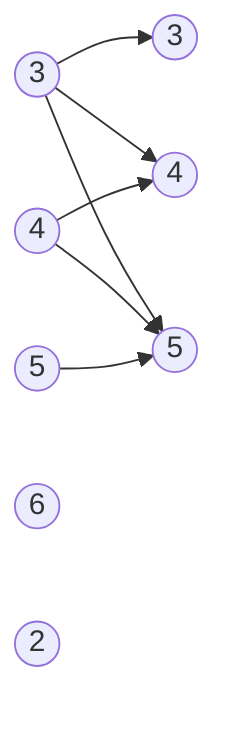
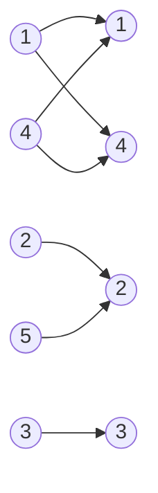

# Домашня робота 5
## Комп'ютерна дискретна математика

Студент: Курушкін Артем Олександрович<br>
Група: ІМ-66

## 1

### 1)

`R = {<x, y> | |x − y| ≤ 1}`, `X = Y = {1, 2, 3, 4}`<br>
**Перелік:** `R = {<1,1>, <1,2>, <2,1>, <2,2>, <2,3>, <3,2>, <3,3>, <3,4>, <4,3>, <4,4>}`<br>
**Матриця** (рядки `1, 2, 3, 4`; стовпці `1, 2, 3, 4`):

$$
\begin{bmatrix}
1 & 1 & 0 & 0 \\
1 & 1 & 1 & 0 \\
0 & 1 & 1 & 1 \\
0 & 0 & 1 & 1
\end{bmatrix}
$$

**Граф:**



**Область визначення:** `{1, 2, 3, 4}`, **область значень:** `{1, 2, 3, 4}`.

### 2)

`R = {<x, y> | x \ y = ∅}`, `X = Y = {A, B, C, D}`, де `A = {0, 1, 2, 3}`, `B = {0, 2}`, `C = {1, 3, 4}`, `D = {1, 2, 3}`<br>
Умова `x \ y = ∅` означає `x ⊆ y` (21). Перевіряємо кожну пару:<br>
`A ⊆ A`; `B ⊆ A`, `B ⊆ B`; `C ⊆ C`; `D ⊆ A`, `D ⊆ D`. Інші включення не виконуються (наприклад, `4 ∈ C`, але `4 ∉ A, B, D`).<br>
**Перелік:** `R = {<A,A>, <B,A>, <B,B>, <C,C>, <D,A>, <D,D>}`<br>
**Матриця** (рядки `A, B, C, D`; стовпці `A, B, C, D`):

$$
\begin{bmatrix}
1 & 0 & 0 & 0 \\
1 & 1 & 0 & 0 \\
0 & 0 & 1 & 0 \\
1 & 0 & 0 & 1
\end{bmatrix}
$$

**Граф:**



**Область визначення:** `{A, B, C, D}`, **область значень:** `{A, B, C, D}`.

## 2

### 1)

`A = {5, 6, 7, 8, 9, 10}`, `B = {1, 2, 3, 4, 5}`, `R = {(a, b) | a − b > 6}`, тобто `a − b ≥ 7`<br>
**Перелік:** `R = {(8,1), (9,1), (9,2), (10,1), (10,2), (10,3)}`<br>
**Матриця** (рядки `5, 6, 7, 8, 9, 10`; стовпці `1, 2, 3, 4, 5`):

$$
\begin{bmatrix}
0 & 0 & 0 & 0 & 0 \\
0 & 0 & 0 & 0 & 0 \\
0 & 0 & 0 & 0 & 0 \\
1 & 0 & 0 & 0 & 0 \\
1 & 1 & 0 & 0 & 0 \\
1 & 1 & 1 & 0 & 0
\end{bmatrix}
$$

**Граф:**



**Область визначення:** `{8, 9, 10}`, **область значень:** `{1, 2, 3}`.

### 2)

`A = {-2, -1, 0, 1, 2}`, `B = {-1, 0, 1}`, `R = {(a, b) | a² > b²}`<br>
Для `b = ±1` потрібно `a² > 1`, тобто `a = ±2`. Для `b = 0` потрібно `a² > 0`, тобто `a ≠ 0`. Для `a = 0` пар немає.<br>
**Перелік:** `R = {(-2,-1), (-2,0), (-2,1), (-1,0), (1,0), (2,-1), (2,0), (2,1)}`<br>
**Матриця** (рядки `-2, -1, 0, 1, 2`; стовпці `-1, 0, 1`):

$$
\begin{bmatrix}
1 & 1 & 1 \\
0 & 1 & 0 \\
0 & 0 & 0 \\
0 & 1 & 0 \\
1 & 1 & 1
\end{bmatrix}
$$

**Граф:**

```mermaid
flowchart LR
  am2((-2)) --> bm1((-1))
  am2 --> b0((0))
  am2 --> b1((1))
  am1((-1)) --> b0
  a0((0))
  a1((1)) --> b0
  a2((2)) --> bm1
  a2 --> b0
  a2 --> b1
```

**Область визначення:** `{-2, -1, 1, 2}`, **область значень:** `{-1, 0, 1}`.

### 3)

`A = {1, 2, 3, 4, 5}`, `B = {2, 3, 4, 5, 6}`, `R = {(a, b) | a > b}`<br>
**Перелік:** `R = {(3,2), (4,2), (4,3), (5,2), (5,3), (5,4)}`<br>
**Матриця** (рядки `1, 2, 3, 4, 5`; стовпці `2, 3, 4, 5, 6`):

$$
\begin{bmatrix}
0 & 0 & 0 & 0 & 0 \\
0 & 0 & 0 & 0 & 0 \\
1 & 0 & 0 & 0 & 0 \\
1 & 1 & 0 & 0 & 0 \\
1 & 1 & 1 & 0 & 0
\end{bmatrix}
$$

**Граф:**



**Область визначення:** `{3, 4, 5}`, **область значень:** `{2, 3, 4}`.

### 4)

`A = {2, 3, 4, 5}`, `B = {4, 5, 6, 7, 8, 9}`, `R = {(a, b) | a — дільник b}`<br>
`2` ділить `4, 6, 8`; `3` ділить `6, 9`; `4` ділить `4, 8`; `5` ділить `5`.<br>
**Перелік:** `R = {(2,4), (2,6), (2,8), (3,6), (3,9), (4,4), (4,8), (5,5)}`<br>
**Матриця** (рядки `2, 3, 4, 5`; стовпці `4, 5, 6, 7, 8, 9`):

$$
\begin{bmatrix}
1 & 0 & 1 & 0 & 1 & 0 \\
0 & 0 & 1 & 0 & 0 & 1 \\
1 & 0 & 0 & 0 & 1 & 0 \\
0 & 1 & 0 & 0 & 0 & 0
\end{bmatrix}
$$

**Граф:**



**Область визначення:** `{2, 3, 4, 5}`, **область значень:** `{4, 5, 6, 8, 9}`.

### 5)

`A = {3, 4, 5, 6, 7}`, `B = {1, 2, 3}`, `R = {(a, b) | a − b < 3}`, тобто `a − b ≤ 2`<br>
**Перелік:** `R = {(3,1), (3,2), (3,3), (4,2), (4,3), (5,3)}`<br>
**Матриця** (рядки `3, 4, 5, 6, 7`; стовпці `1, 2, 3`):

$$
\begin{bmatrix}
1 & 1 & 1 \\
0 & 1 & 1 \\
0 & 0 & 1 \\
0 & 0 & 0 \\
0 & 0 & 0
\end{bmatrix}
$$

**Граф:**



**Область визначення:** `{3, 4, 5}`, **область значень:** `{1, 2, 3}`.

### 6)

`A = {3, 4, 5, 6}`, `B = {2, 3, 4, 5}`, `R = {(a, b) | a² − b² ≤ 0}`<br>
Усі елементи додатні, тому `a² ≤ b²` рівносильно `a ≤ b`.<br>
**Перелік:** `R = {(3,3), (3,4), (3,5), (4,4), (4,5), (5,5)}`<br>
**Матриця** (рядки `3, 4, 5, 6`; стовпці `2, 3, 4, 5`):

$$
\begin{bmatrix}
0 & 1 & 1 & 1 \\
0 & 0 & 1 & 1 \\
0 & 0 & 0 & 1 \\
0 & 0 & 0 & 0
\end{bmatrix}
$$

**Граф:**



**Область визначення:** `{3, 4, 5}`, **область значень:** `{3, 4, 5}`.

### 7)

`A = {1, 2, 3, 4, 5}`, `B = {1, 2, 3, 4}`, `R = {(a, b) | a ≡ b (mod 3)}`<br>
Остачі від ділення на 3: у `A` це `1→1, 2→2, 3→0, 4→1, 5→2`; у `B` це `1→1, 2→2, 3→0, 4→1`.<br>
**Перелік:** `R = {(1,1), (1,4), (2,2), (3,3), (4,1), (4,4), (5,2)}`<br>
**Матриця** (рядки `1, 2, 3, 4, 5`; стовпці `1, 2, 3, 4`):

$$
\begin{bmatrix}
1 & 0 & 0 & 1 \\
0 & 1 & 0 & 0 \\
0 & 0 & 1 & 0 \\
1 & 0 & 0 & 1 \\
0 & 1 & 0 & 0
\end{bmatrix}
$$

**Граф:**



**Область визначення:** `{1, 2, 3, 4, 5}`, **область значень:** `{1, 2, 3, 4}`.
