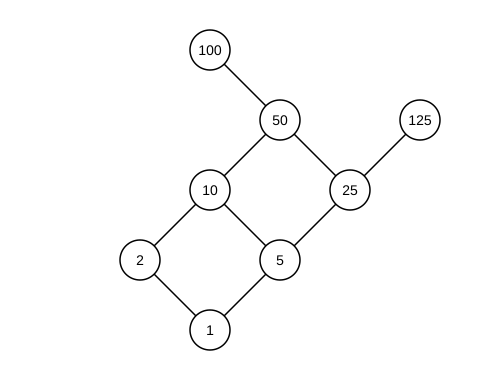
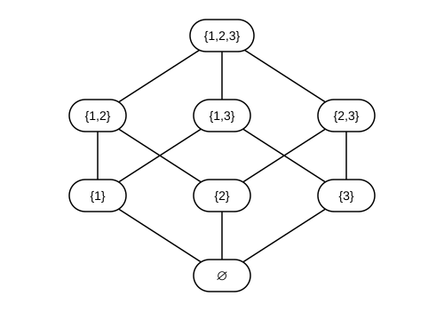
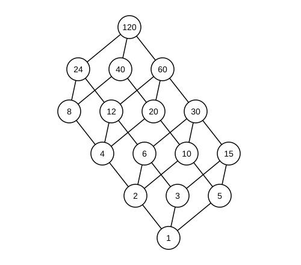

# Домашня робота 9
## Комп'ютерна дискретна математика

Студент: Курушкін Артем Олександрович 
Група: ІМ-66

## 1

Множина цілих чисел `ℤ`.

### 1)

`R1: a R1 b ⇔ a ≤ b` 
**Рефлексивність:** так, `a ≤ a`. 
**Антисиметричність:** так, з `a ≤ b` і `b ≤ a` випливає `a = b`. 
**Транзитивність:** так, з `a ≤ b` і `b ≤ c` випливає `a ≤ c`. 
**Відповідь:** так, це відношення (нестрогого лінійного) порядку.

### 2)

`R2: a R2 b ⇔ a ≥ b` 
**Рефлексивність:** так, `a ≥ a`. 
**Антисиметричність:** так, з `a ≥ b` і `b ≥ a` випливає `a = b`. 
**Транзитивність:** так, з `a ≥ b` і `b ≥ c` випливає `a ≥ c`. 
**Відповідь:** так, це відношення (нестрогого лінійного) порядку.

### 3)

`R3: a R3 b ⇔ a < b` 
**Рефлексивність:** ні, `a < a` хибно (відношення антирефлексивне). 
**Антисиметричність:** так, `a < b` і `b < a` одночасно неможливі. 
**Транзитивність:** так, з `a < b` і `b < c` випливає `a < c`. 
**Відповідь:** не є відношенням нестрогого порядку (бо не рефлексивне), але є відношенням строгого порядку.

### 4)

`R4: a R4 b ⇔ a² ≤ b²` 
**Рефлексивність:** так, `a² ≤ a²`. 
**Антисиметричність:** ні, на `ℤ` маємо `(−1)² ≤ 1²` і `1² ≤ (−1)²`, тобто `−1 R4 1` і `1 R4 −1`, але `−1 ≠ 1`. 
**Транзитивність:** так, з `a² ≤ b²` і `b² ≤ c²` випливає `a² ≤ c²`. 
**Відповідь:** ні, не є відношенням порядку (не антисиметричне).

### 5)

`R5: a R5 b ⇔ a = b` 
**Рефлексивність:** так, `a = a`. 
**Антисиметричність:** так, з `a = b` і `b = a` випливає `a = b`. 
**Транзитивність:** так, з `a = b` і `b = c` випливає `a = c`. 
**Відповідь:** так, це відношення (нестрогого часткового) порядку.

### 6)

`R6: a R6 b ⇔ a ділиться на b` 
**Рефлексивність:** для `a ≠ 0` виконується (`a` ділиться на `a`); для `a = 0` ділення на `0` не визначене. 
**Антисиметричність:** ні, на `ℤ` число `1` ділиться на `−1` і `−1` ділиться на `1`, але `1 ≠ −1`. 
**Транзитивність:** так, якщо `a` ділиться на `b` і `b` ділиться на `c`, то `a` ділиться на `c`. 
**Відповідь:** ні, на множині `ℤ` не є відношенням порядку (не антисиметричне).

### 7)

`R7: a R7 b ⇔ НСД(a, b) = 1` 
**Рефлексивність:** ні, `НСД(2, 2) = 2 ≠ 1`. 
**Антисиметричність:** ні, `НСД(2, 3) = 1` і `НСД(3, 2) = 1`, але `2 ≠ 3`. 
**Транзитивність:** ні, `НСД(2, 3) = 1` і `НСД(3, 4) = 1`, але `НСД(2, 4) = 2 ≠ 1`. 
**Відповідь:** ні, не є відношенням порядку.

## 2

### 1)

`A = {1, 2, 3, 4, 5, 6, 7, 8}`, `R = {(x, y) ∈ A × A | x ≤ y}` 
Відношення `≤` є лінійним порядком на `A`, тому будь-які два елементи `x, y ∈ A` порівнянні. Для кожної пари існують `inf(x, y) = min(x, y) ∈ A` та `sup(x, y) = max(x, y) ∈ A`. 
**Відповідь:** так, є ґраткою.

### 2)

`A = {1, 2, 3, 5, 6, 10, 15, 30}`, `R = {(x, y) ∈ A × A | y ділиться на x}` 
Множина `A` містить усі натуральні дільники числа `30`. Відношення подільності на `A` є відношенням нестрогого часткового порядку. Для будь-яких `x, y ∈ A` їхні `НСД(x, y)` та `НСК(x, y)` також є дільниками `30`, тому належать `A`. Отже, для кожної пари існують `inf(x, y) = НСД(x, y) ∈ A` та `sup(x, y) = НСК(x, y) ∈ A`. 
**Відповідь:** так, є ґраткою.

### 3)

`A = {2, 3, 4, 6, 8, 9, 12, 18, 24, 36}`, `R = {(x, y) ∈ A × A | y ділиться на x}` 
Для пари елементів `2` і `3` немає спільної нижньої межі в `A` (`НСД(2, 3) = 1 ∉ A`), тобто `inf(2, 3)` не існує. Так само для пари `8` і `9` немає спільної верхньої межі в `A` (`НСК(8, 9) = 72 ∉ A`), тобто `sup(8, 9)` не існує. 
**Відповідь:** ні, не є ґраткою.

## 3

### 1)

`A = {1, 2, 5, 10, 25, 50, 100, 125}`, `R = {(x, y) ∈ A × A | y ділиться на x}` 
**Рівні (за сумою степенів у розкладі `2ᵃ · 5ᵇ`):** рівень 0: `1`; рівень 1: `2, 5`; рівень 2: `10, 25`; рівень 3: `50, 125`; рівень 4: `100`. 
**Ребра покриття (знизу вгору):** `(1,2), (1,5), (2,10), (5,10), (5,25), (10,50), (25,50), (25,125), (50,100)`. 
**Діаграма Гассе:**

**Відповідь:** не є ґраткою, бо для максимальних елементів `100` і `125` немає спільної верхньої межі в `A` (`НСК(100, 125) = 500 ∉ A`), отже `sup(100, 125)` не існує.

### 2)

`A = 2^{{1,2,3}} = {∅, {1}, {2}, {3}, {1,2}, {1,3}, {2,3}, {1,2,3}}`, `R = {(x, y) | x ⊆ y}` 
**Рівні (за потужністю підмножин):** рівень 0: `∅`; рівень 1: `{1}, {2}, {3}`; рівень 2: `{1,2}, {1,3}, {2,3}`; рівень 3: `{1,2,3}`. 
**Ребра покриття (знизу вгору):** `(∅,{1}), (∅,{2}), (∅,{3}), ({1},{1,2}), ({1},{1,3}), ({2},{1,2}), ({2},{2,3}), ({3},{1,3}), ({3},{2,3}), ({1,2},{1,2,3}), ({1,3},{1,2,3}), ({2,3},{1,2,3})`. 
**Діаграма Гассе:**

**Відповідь:** так, є ґраткою, оскільки для будь-яких `X, Y ∈ A` існують `inf(X, Y) = X ∩ Y ∈ A` та `sup(X, Y) = X ∪ Y ∈ A`.

### 3)

`A = {1, 2, 3, 4, 5, 6, 8, 10, 12, 15, 20, 24, 30, 40, 60, 120}`, `R = {(x, y) | y ділиться на x}` 
**Рівні (за сумою степенів у розкладі `2ᵃ · 3ᵇ · 5ᶜ`):** рівень 0: `1`; рівень 1: `2, 3, 5`; рівень 2: `4, 6, 10, 15`; рівень 3: `8, 12, 20, 30`; рівень 4: `24, 40, 60`; рівень 5: `120`. 
**Ребра покриття (`y / x ∈ {2, 3, 5}`):** `(1,2), (1,3), (1,5), (2,4), (2,6), (2,10), (3,6), (3,15), (5,10), (5,15), (4,8), (4,12), (4,20), (6,12), (6,30), (10,20), (10,30), (15,30), (8,24), (8,40), (12,24), (12,60), (20,40), (20,60), (30,60), (24,120), (40,120), (60,120)`. 
**Діаграма Гассе:**

**Відповідь:** так, є ґраткою, оскільки `A` — множина всіх дільників числа `120`, тому для будь-яких `x, y ∈ A` існують `inf(x, y) = НСД(x, y) ∈ A` та `sup(x, y) = НСК(x, y) ∈ A`.
